<h1 align="center">whoami-cms</h1>

<strong>Il tuo portfolio. I tuoi contenuti. Un solo admin nascosto.</strong>

<a href="README.md">English</a> · <strong>Italiano</strong> · <a href="README.tecnico.md">README tecnico</a>

  
  
  
  

whoami-cms è un portfolio personale per sviluppatori che possiedi e modifichi da un **pannello admin nascosto**. Il sito pubblico è una pagina unica già disegnata, in italiano e in inglese; i contenuti (profilo, esperienza, progetti, formazione, certificazioni, competenze) stanno in un unico file SQLite che compili dal browser. Niente page builder, niente plugin, niente server di database.

  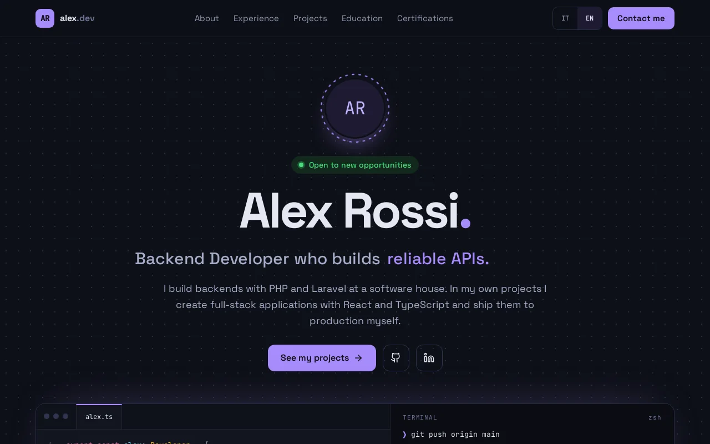

> I contenuti demo sono quelli di un profilo inventato, *Alex Rossi*. Il sito pubblico esiste in inglese e in italiano; per ora l'**interfaccia dell'admin è solo in italiano**.

## Perché whoami-cms

- **È tuo.** Il tuo server, i tuoi dati in un file che puoi scaricare, nessun servizio ospitato in mezzo.
- **Un design finito, non una tela bianca.** Il layout è fisso e pensato prima per il telefono: scrivi solo i contenuti, e il risultato è sempre curato.
- **Nascosto per scelta.** L'admin si raggiunge solo scrivendo `/admin`: nessun link, nessuna indicizzazione, una sola password che non tocca mai il database.
- **Bilingue fin dall'inizio.** Ogni testo ha una versione italiana e una inglese, e la lingua del visitatore viene ricordata.

## Funzionalità

### Il sito pubblico

- **Hero** con nome, ruolo, frasi a rotazione, badge «aperto a nuove opportunità», foto (o iniziali), link a GitHub e LinkedIn e un pulsante per scaricare il CV.
- **Chi sono** con una frase d'apertura, la tua storia e numeri calcolati dai tuoi dati: anni di esperienza, progetti personali, certificazioni, tecnologie nello stack.
- **Stack** raggruppato per area, con un livello per ogni competenza (base, intermedio, avanzato, esperto) mostrato a tacche; **lingue** con livelli CEFR.
- **Esperienza** con ruolo, azienda, date, descrizione, tecnologie e i progetti seguiti, ognuno una card cliccabile.
- **Progetti personali** con una card in evidenza e una griglia filtrabile (app, librerie, infrastruttura), con link a repository, demo o pagina del pacchetto.
- **Formazione** e **certificazioni**, con codici credenziale e link di verifica. I percorsi passati si possono nascondere invece di eliminarli.
- **Modulo contatti** con campo trappola (honeypot) e limite di richieste. I messaggi restano nell'admin e arrivano anche via email.
- **PWA installabile**: la aggiungi alla schermata Home e si apre anche offline con gli ultimi contenuti visti.

### L'admin nascosto

- **Una sola password**, impostata come hash nell'ambiente, con blocco dopo ripetuti errori.
- **Tutto modificabile** a sezioni: profilo, esperienza, progetti, formazione, certificazioni, competenze e lingue. Si riordina con le frecce, si nasconde una voce, si mette un progetto in evidenza, si accende il badge di disponibilità.
- **Caricamento di foto e CV**; il pulsante per scaricare il CV mostra la dimensione del file.
- **Generatore di CV**: dagli stessi contenuti, in italiano o in inglese, crea un PDF pulito a due colonne direttamente nel tuo browser (niente esce da lì) e lo può pubblicare come CV del sito. I dati riservati, come data di nascita o indirizzo, servono solo al PDF e non arrivano mai al sito pubblico.
- **Schede italiano e inglese** su ogni testo. Con una chiave DeepL i testi inglesi vuoti vengono tradotti al salvataggio e segnati *da controllare* finché non li approvi.
- **Posta in arrivo** del modulo contatti: segna come letto, elimina, rispondi.
- **Backup e ripristino** dell'intero database con due clic.

### Fatto per essere pubblicato

- Due immagini Docker di produzione e un workflow GitHub Actions che testa, costruisce e pubblica.
- Controlli di salute, log in JSON per gli strumenti di raccolta e intestazioni di sicurezza rigorose già pronti.

## Screenshot

### Il sito

  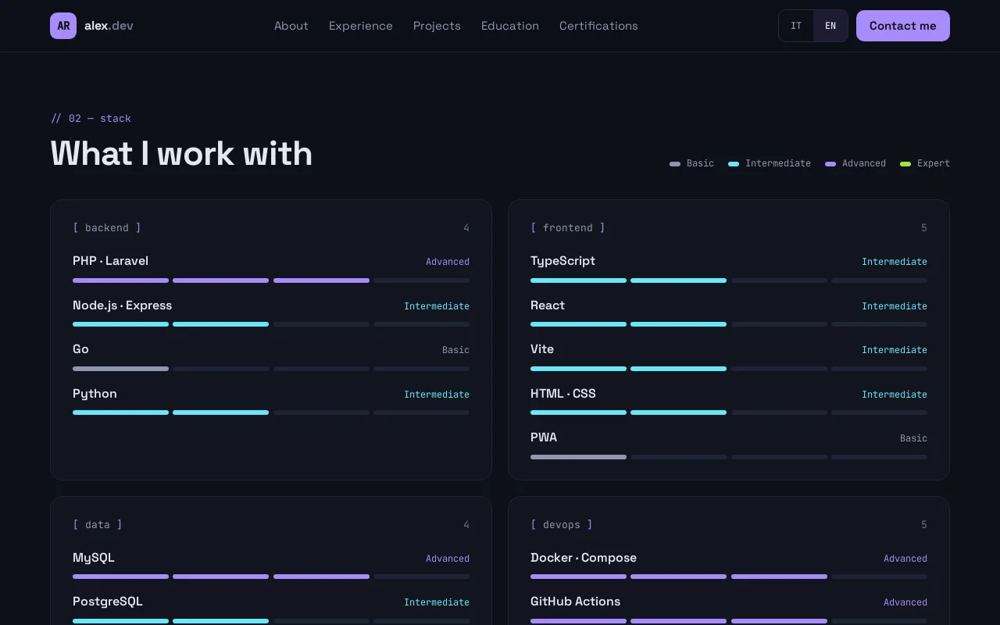
  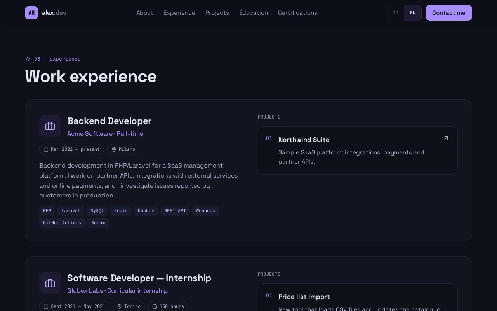

  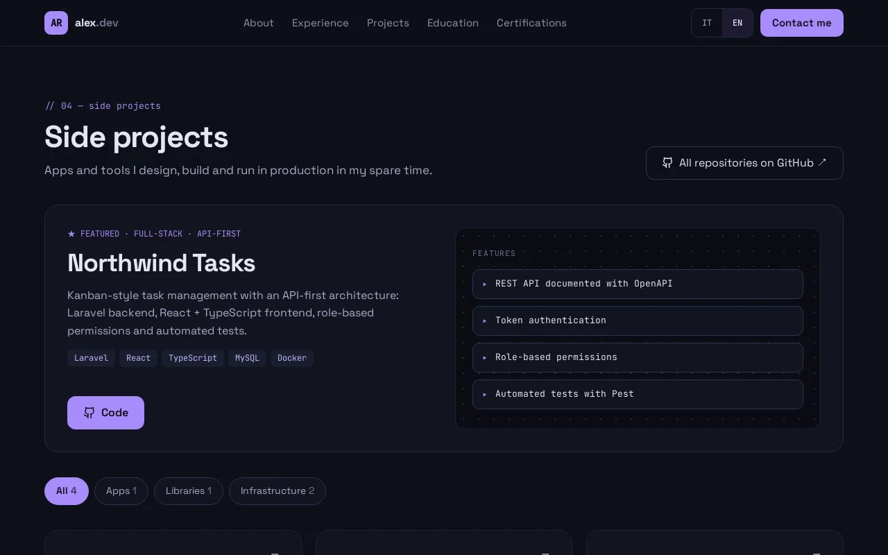

### Su telefono

  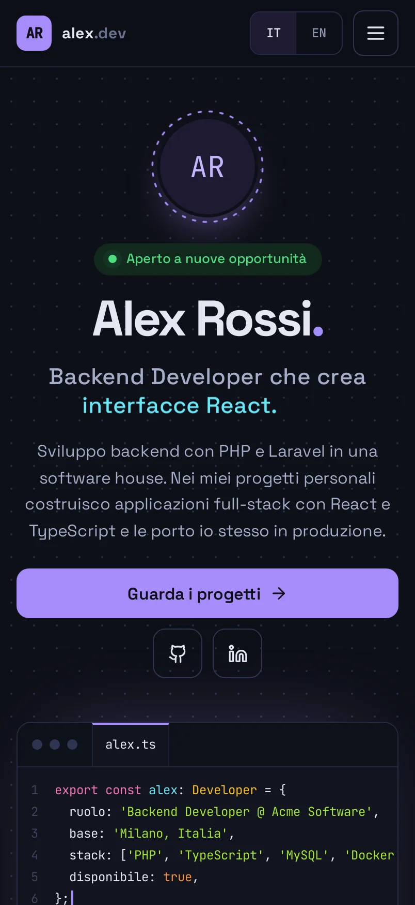
  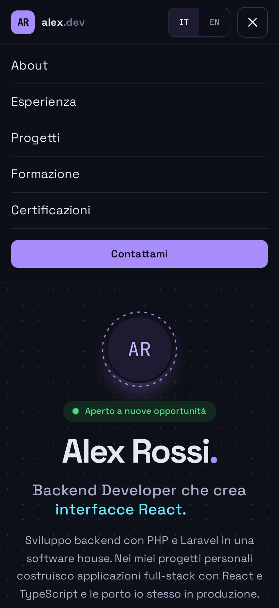
  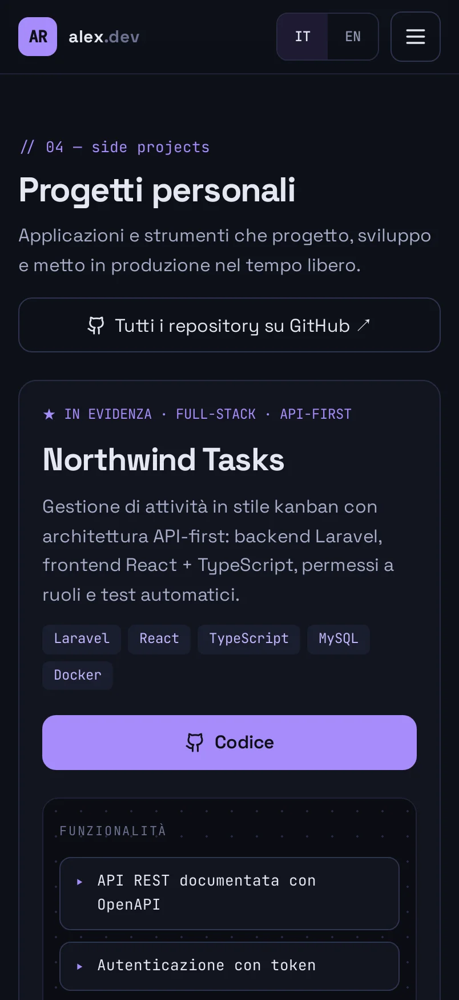

### L'admin

  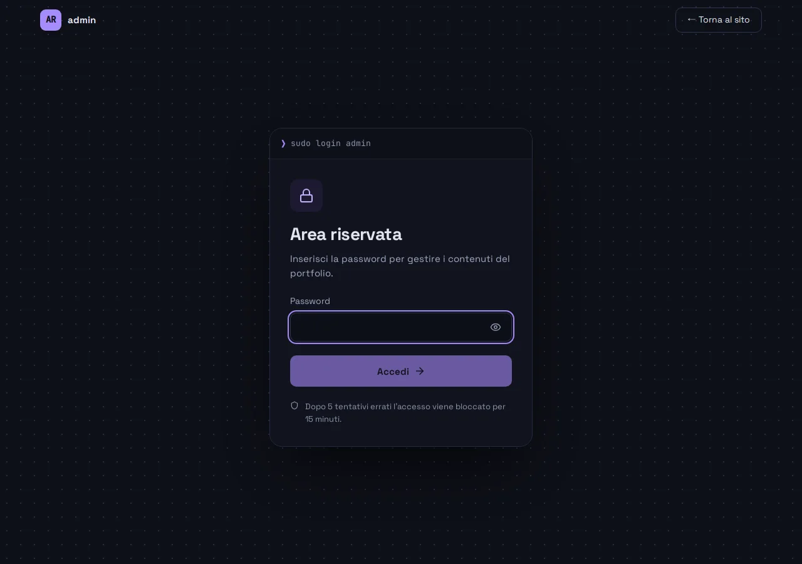
  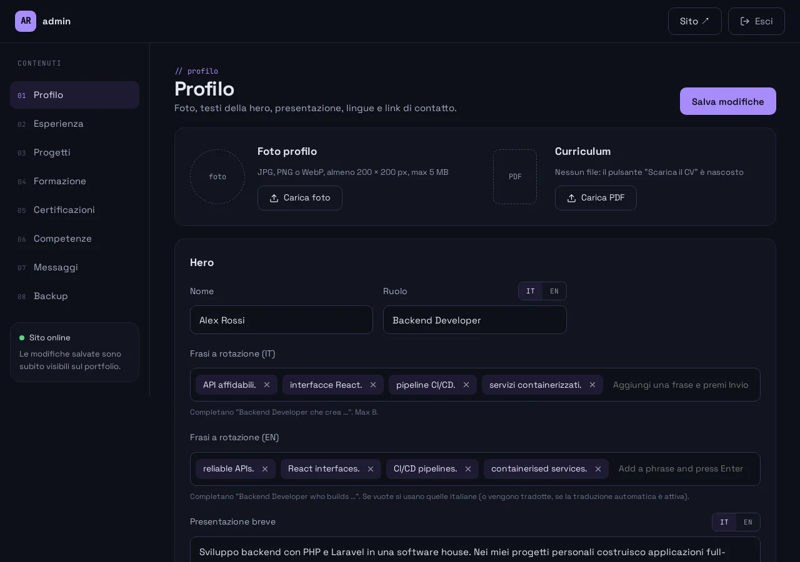

  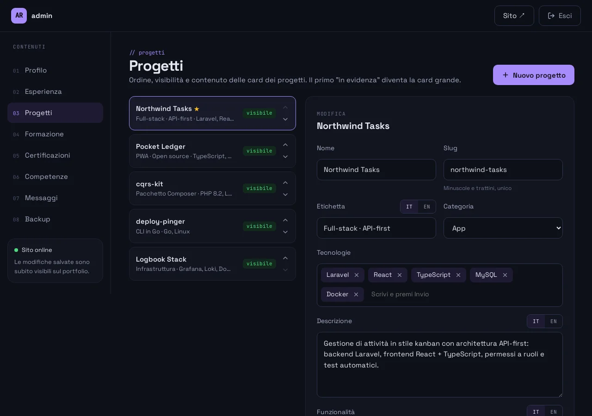
  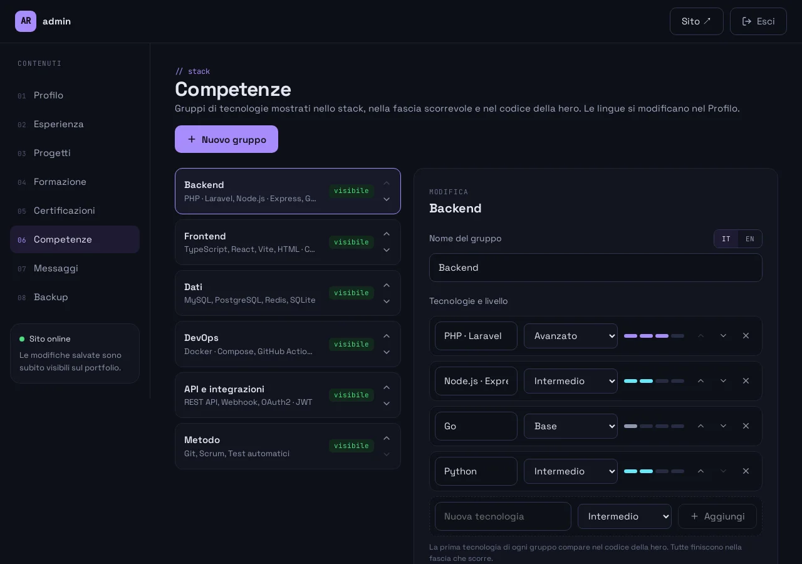

  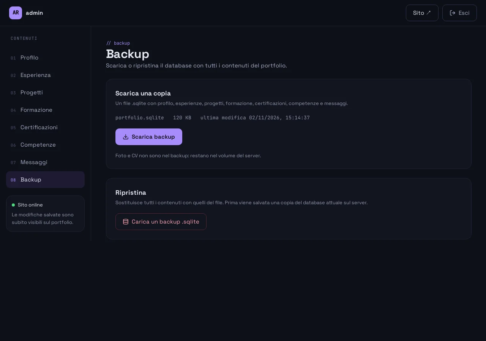

## Stack tecnico

Laravel 13 (PHP 8.4-FPM) · SQLite · React 19 + TypeScript + Vite · Nginx · Docker · GitHub Actions.

## Avvio, configurazione e deploy

Installazione locale, configurazione, guida all'admin, backup, deploy e test sono nel **[README tecnico](README.tecnico.md)**. Per segnalare un problema di sicurezza vedi [SECURITY.md](SECURITY.md).

## Licenza

[MIT](LICENSE).
