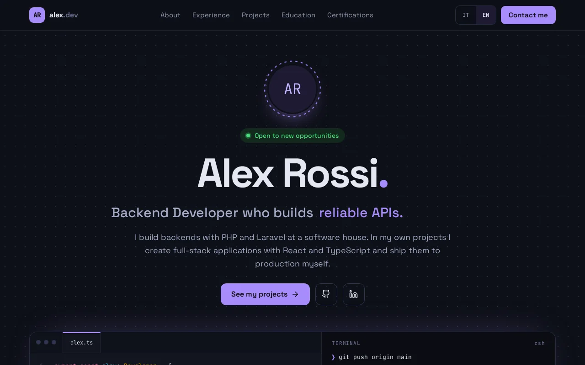
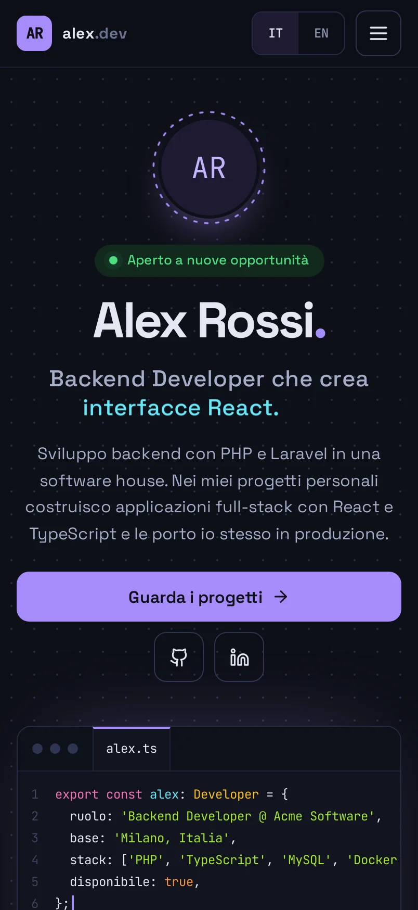
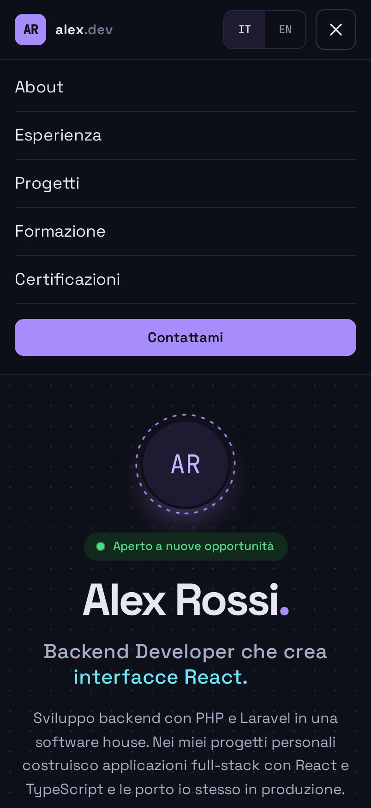
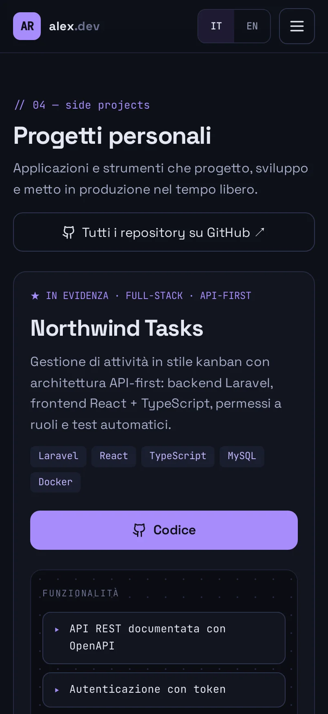
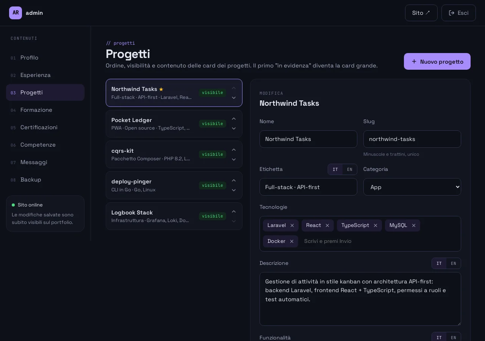
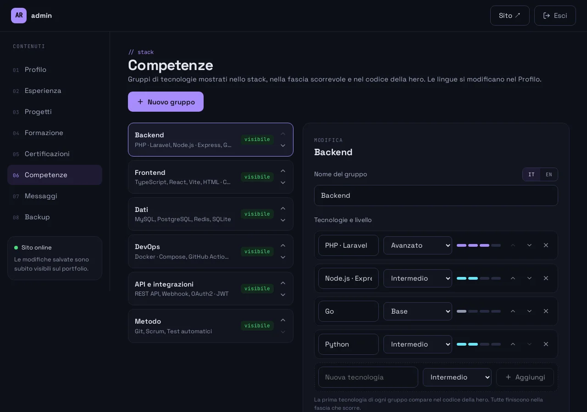
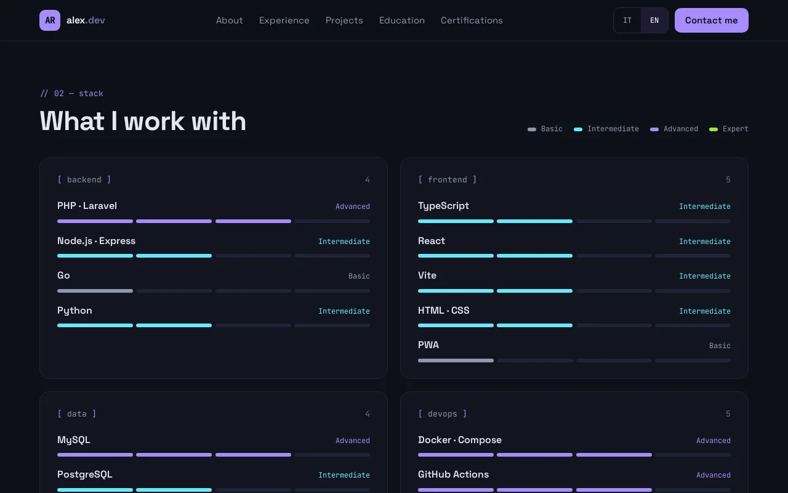
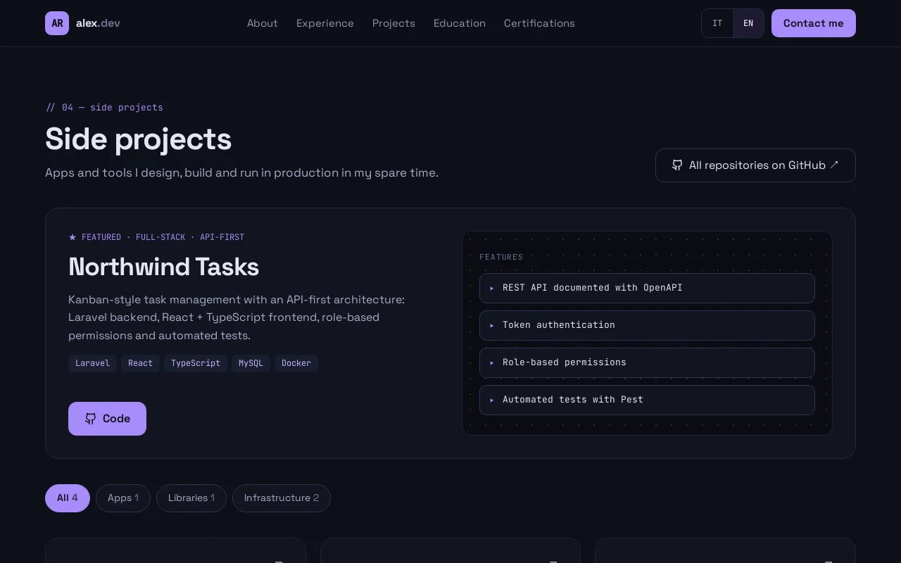

# whoami-cms

<p align="center"><strong>English</strong> · <a href="README.it.md">Italiano</a></p>

**A personal portfolio you own and edit from a hidden admin panel.** Public site in Italian and English, a single-password admin at `/admin`, a database in one SQLite file, and Docker images ready to deploy. No page builder, no plugins: a small Laravel API and a React site that you fill in from the browser.

<p align="center">
  
</p>

<p align="center">
  
  
  
</p>

> The demo content is a made-up developer, *Alex Rossi*. The public site has an English and an Italian version; the **admin interface is in Italian** for now.

## What you get

- **One-page site** with hero, about, stack with skill levels, experience, personal projects, education, certifications and a contact form.
- **Italian and English** versions of every text, switchable from the page, with the language remembered.
- **Hidden admin** reachable only by typing `/admin`: no link anywhere, `noindex`, one password that you set in the environment, never in the database.
- **Everything editable**: profile, photo and CV, experience, projects, education, certifications, skills and languages (CEFR levels). Reorder items, hide them, mark a project as featured, switch the "open to opportunities" badge on and off.
- **Contact form** with honeypot and rate limit. Messages are stored in the admin and forwarded to your e-mail.
- **Backup and restore** of the whole database from the admin.
- **Installable PWA** that also opens offline with the last content seen.
- **Optional automatic translation** Italian → English with DeepL, with a "needs review" flag until you approve each text.
- **Production images** for Docker and a GitHub Actions workflow that tests, builds and pushes them.

## The admin

<p align="center">
  
  
</p>

## More of the site

<p align="center">
  
  
</p>

## Quick start

You only need Docker.

```bash
cp backend/.env.example backend/.env
docker compose up -d
docker compose exec app composer install
docker compose exec app php artisan key:generate
docker compose exec app php artisan migrate --seed
docker compose exec app php artisan storage:link
docker compose exec app php artisan admin:hash-password
```

Paste the printed `ADMIN_PASSWORD_HASH='…'` line into `backend/.env`, then open:

- site: <http://localhost:5174>
- admin: <http://localhost:5174/admin>
- test e-mails (Mailpit): <http://localhost:8026>

The seeder loads the demo profile and refuses to run twice, so it never overwrites what you edit. To start from your own content, open the admin and replace every text.

## Make it yours

1. **Content**: edit everything from `/admin`.
2. **Name, title and meta tags**: copy `frontend/.env.example` to `frontend/.env` and set `VITE_SITE_NAME`, `VITE_SITE_TAGLINE`, `VITE_SITE_DESCRIPTION`, `VITE_SITE_SHORT_NAME` and `VITE_SITE_INITIALS`.
3. **Icons**: replace the files in `frontend/public/icons/` and `frontend/public/favicon.svg`.
4. **Fixed texts** (menu, headings): `frontend/src/lib/i18n.tsx`.

## Documentation

- [Technical guide](docs/TECHNICAL.md): architecture, configuration, admin guide, backup, deploy, tests ([italiano](docs/TECHNICAL.it.md)).
- [Security policy](SECURITY.md).

## Stack

Laravel 13 (PHP 8.4-FPM) · SQLite · React 19 + TypeScript + Vite · Nginx · Docker · GitHub Actions.

## License

[MIT](LICENSE).
